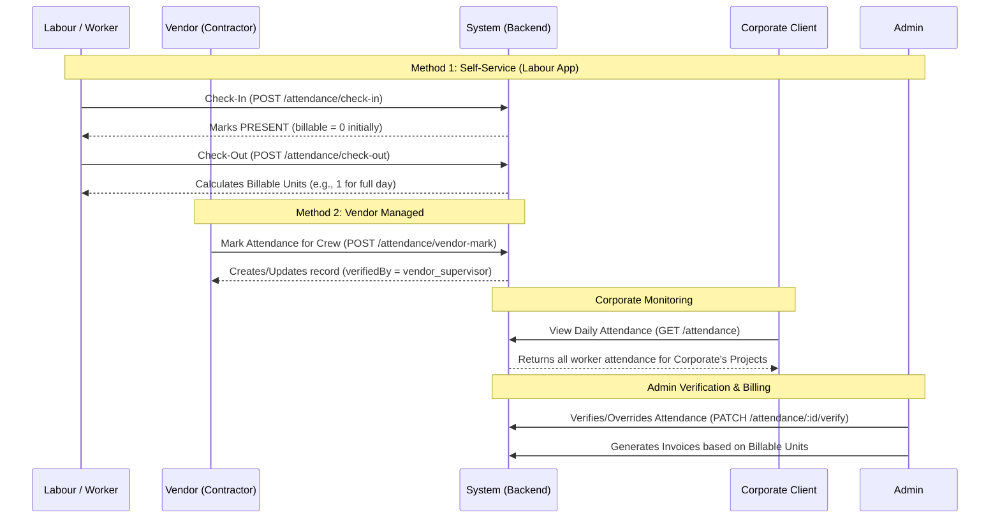

# Workforce Attendance Flow

This document outlines the end-to-end Attendance Flow in the Mappto system, detailing how workers (Labour), Vendors (Contractors), Corporate Clients, and Admins interact with attendance records.

## High-Level Architecture

## Detailed Steps

### 1. Daily Check-In & Check-Out (Labour/Worker)
- **Check-In**: When a worker arrives at the site, they use their app to check in. The backend creates an `AttendanceRecord` for that `assignmentId` and `shiftDate`, defaulting to `PRESENT`.
- **Check-Out**: When the shift ends, they check out. The backend records the `checkOutAt` time and calculates `billableUnits` (e.g., `1` for a full day, `0.5` for a half day).

### 2. Vendor / Contractor Management
- A Contractor managing a crew of workers can mark attendance on their behalf using `markAttendanceVendor`.
- This creates an attendance record with `verifiedBy: 'vendor_supervisor'`, bypassing the need for individual workers to check in themselves.

### 3. Corporate Visibility
- The Corporate Client can monitor live attendance for their sites via the Corporate Panel using `GET /attendance`.
- The dashboard displays analytics, showing trends of `PRESENT` vs `ABSENT` workers (via the newly added `/api/v1/corporate/analytics` endpoint).

### 4. Admin Verification & Invoicing
- Admins can review all attendance records and override them if there are disputes (e.g., a worker forgot to check out).
- At the end of the billing cycle, the system aggregates the `billableUnits` from `AttendanceRecord`s to generate a `milestone` or `attendance` based `Invoice`.

> [!TIP]
> **Next Steps for Frontend Integration:** 
> - Ensure the Labour App has clear Check-In/Check-Out buttons on their active assignment screen.
> - Ensure the Vendor App has a "Bulk Mark Attendance" list view.
> - Ensure the Corporate Panel visualizes the Attendance Table.
